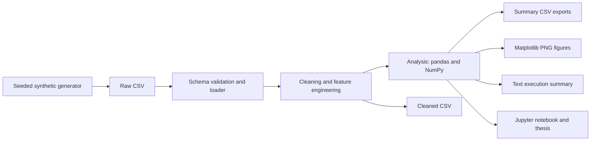
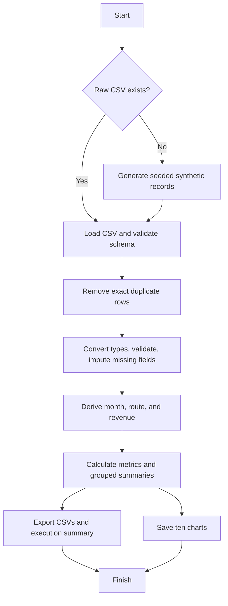
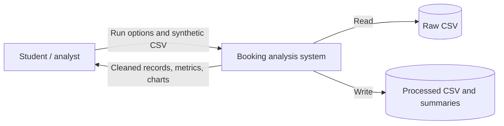
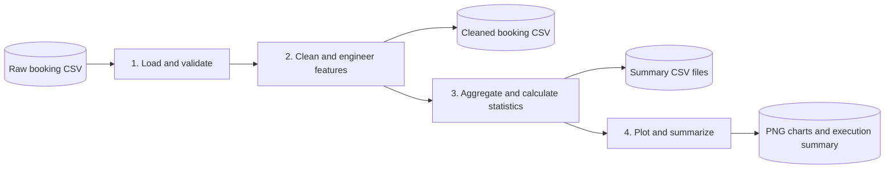
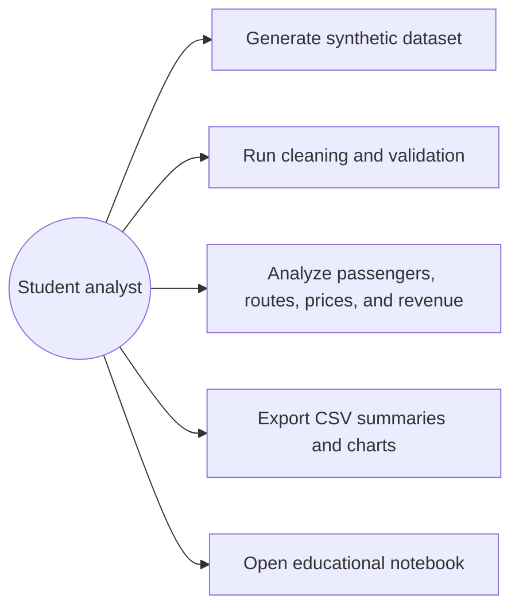
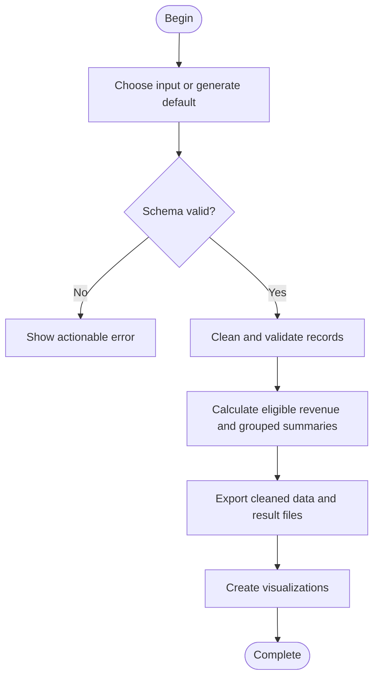

# System Architecture and Diagrams

All diagrams are editable Mermaid source. The Python application is a local batch-analysis tool; no network service or booking/payment system is implemented.

## Architecture

## Project Workflow

## Data Flow Diagram (Level 0)

## Data Flow Diagram (Level 1)

## Use Cases

## Activity Diagram

